# Ozoo.ai Outreach Agent — Plan v2

> Updated from `email-whatsapp-flows.pdf` after CTO/PM review.
> **Scope:** leads come from elsewhere. We handle everything **after** a lead arrives.

### Changes after review (v2.1, 2026-11-13)

| # | Review feedback | What changed |
|---|---|---|
| 1 | Don't reject leads without permission (§4) | Cold B2B email needs **no opt-in**. Only WhatsApp needs opt-in. A lead is rejected only when it has no valid email and no WhatsApp opt-in. |
| 2 | Don't act on email opens (§5) | Opens are **logged for reporting only**. They no longer change score, content, subject line, timing or end-of-sequence route (§5d, §5f, §5h, §5i). |
| 3 | Remove "try WhatsApp later" (§5h) | Gone. Leads with WhatsApp opt-in already get WhatsApp on day 1. |
| 4 | When do paused colleagues restart? (§11) | Restart rules per outcome: new table in §11. |
| 5 | EU email + website tracking need approval | EU leads are held (no email) until `EU_EMAIL_APPROVED` is switched on. The website tracking script stays off until approved. Both are on the go-live checklist (§18). |

**Legend used in diagrams:** 🟦 agent does it · 🟨 decision · 🟩 human does it · 🟥 stop · ⬜ nurture

---

## 1. The big picture — what's ours

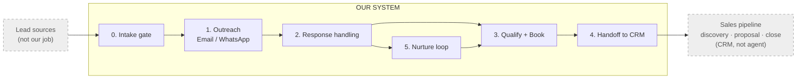

**Our finish line = a qualified meeting booked and handed to sales with full context.**
Proposal / won / lost from the old PDF = sales team's CRM. We only *read* those stages back.

---

## 2. What changed vs the old PDF

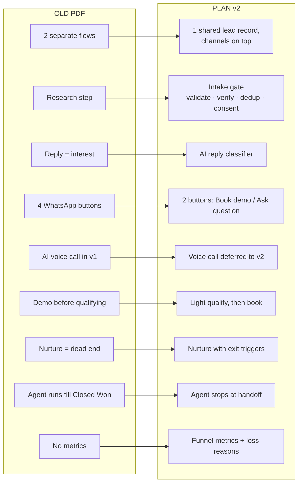

---

## 3. Where the old plan breaks — bottleneck map

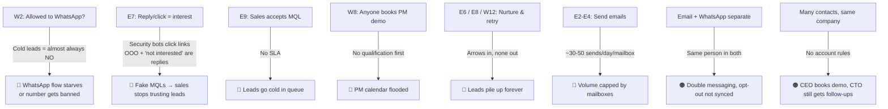

---

## 4. Step 0 — Intake gate (every lead passes here first)

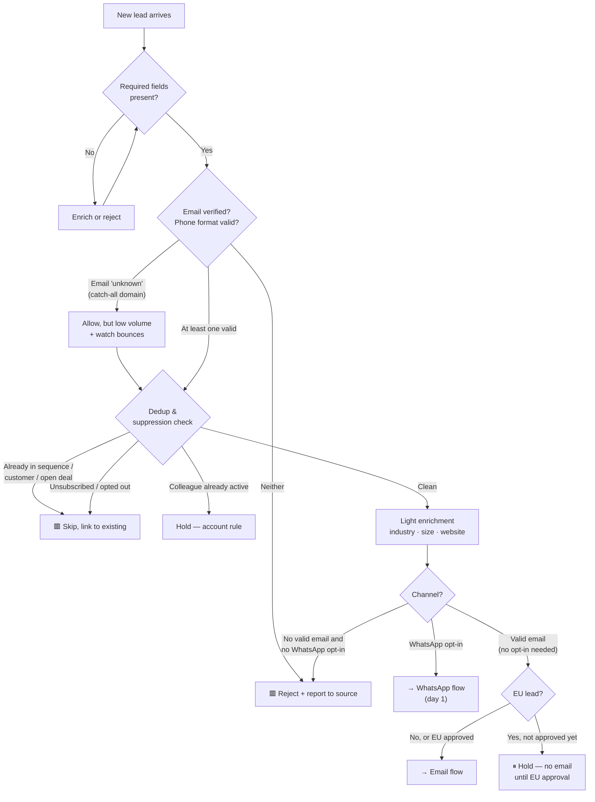

**Required fields (lead contract):**

| Field | Required | Why |
|---|---|---|
| Name, company, role | ✅ | Personalisation |
| Email and/or phone | ✅ (one) | Channel |
| Lead source | ✅ | Measure which source converts |
| WhatsApp opt-in + date | Only for WhatsApp | WhatsApp rules, audit. **Email needs no opt-in** (cold B2B email is allowed with an unsubscribe in every email) |
| Country | Nice to have | EU leads need approval before email (also guessed from phone / email domain) |
| Industry / size / pain | Nice to have | Email 1 quality |

> ⚠️ **We cannot check in advance if a number is on WhatsApp** — Meta doesn't allow it. We find out at the first send (message fails → lead falls back to email).

---

## 5. Email flow v2 — every tracked event

### 5a. Everything we can track on one email

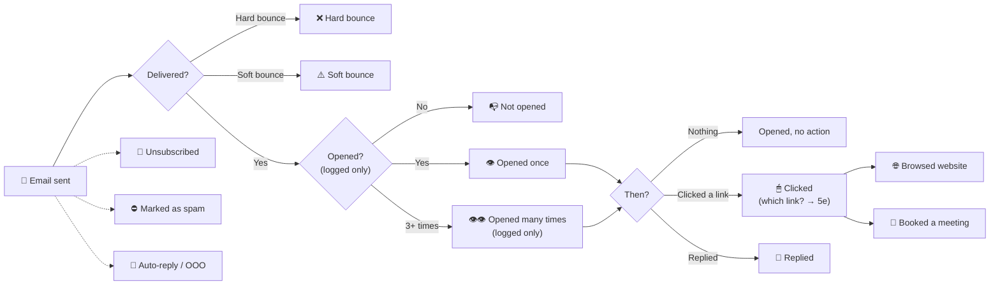

| Event | How we detect it | Trust level |
|---|---|---|
| Delivered | Email provider webhook | ✅ High |
| Hard / soft bounce | Email provider webhook | ✅ High |
| Opened | Tracking pixel | ⚠️ Low — Apple Mail fakes opens, Outlook blocks images. **Logged only, never acted on** |
| Clicked link | Tracked redirect link | 🟡 Medium — security bots click links |
| Browsed website | Website tracking script on landing pages | 🟡 Medium — **needs approval first, off until then** |
| Booked meeting | Calendar webhook | ✅ High |
| Replied | Inbox sync | ✅ High |
| Auto-reply / OOO | Reply classifier | ✅ High |
| Unsubscribed | Unsubscribe link / header | ✅ High |
| Marked as spam | Gmail: **only overall %**, never which person. Yahoo/Outlook per-person only with feedback loops set up | ⚠️ Mostly mailbox-level, rarely per lead |

---

### 5b. Step 1 — Filter out fake opens & clicks (before anything else)

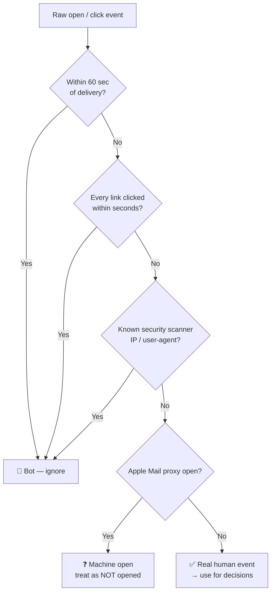

**Rule:** only ✅ human **clicks** (and replies, bookings, unsubscribes) change the flow. Bots are logged, never acted on. Opens — even human ones — are logged only.

---

### 5c. Step 2 — Delivery check (minutes after sending)

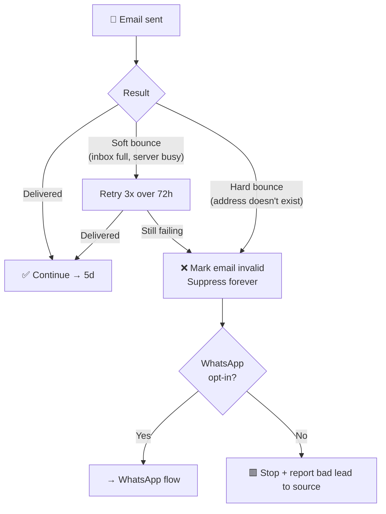

---

### 5d. Step 3 — After each email, during the wait (Email 1, 2, 3)

The agent checks the lead **every time an event comes in**, not only on the day of the next email.

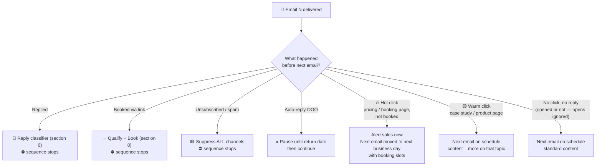

**Opens never drive an action** — not content, subject, timing, score or routing. Every email already has its own subject line, so there is no "new subject if not opened" rule.

**Smart timing:** if the lead **clicked or replied** at 9 pm, send the next email around 9 pm their time. Open times are not used.

**Never say "I saw you opened / clicked"** in an email — feels like spying, and opens are often fake.

---

### 5e. Which link they clicked → what we do

Every link in every email has a **purpose tag**.

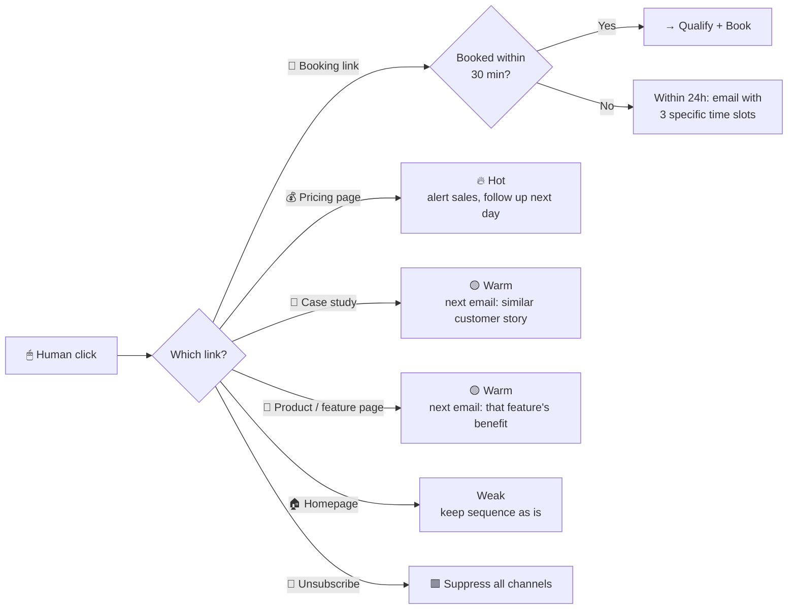

**Website follow-through (only after the tracking script is approved — off until then):**

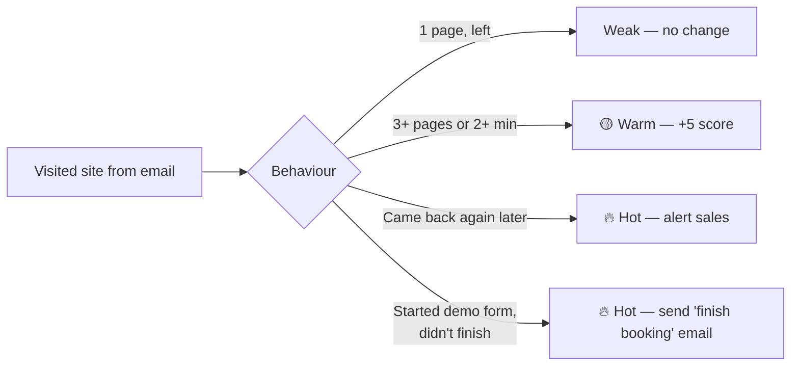

---

### 5f. Engagement score — adds up all events

| Human event | Points |
|---|---|
| Opened | 0 — logged only |
| Homepage click | +2 |
| Product / case study click | +5 |
| Website: 3+ pages | +5 |
| Pricing click | +10 |
| Booking link click (not booked) | +10 |
| Came back to site again | +10 |
| Positive reply / booked | → straight to Qualify |
| Unsubscribe / spam | → stop, score irrelevant |
| No activity for 30 days | score halves |

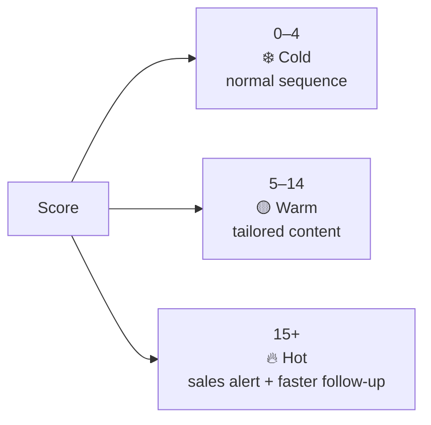

---

### 5g. Full 4-email sequence with all branches

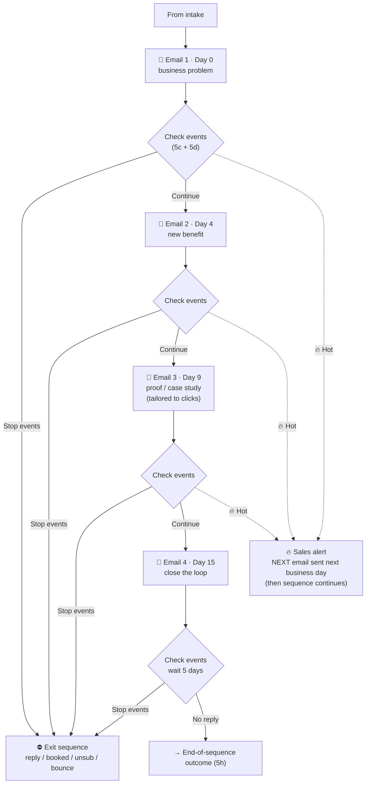

---

### 5h. After Email 4 — what kind of silence was it?

No reply doesn't mean the same thing for everyone. Clicks and score decide the next path — **opens are not used**, and there is **no "try WhatsApp" step**: leads with WhatsApp opt-in already got WhatsApp on day 1.

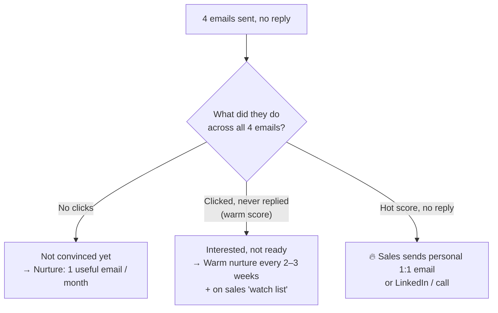

---

### 5i. Cheat sheet — event → action

| Event | Action | Sequence |
|---|---|---|
| Hard bounce | Suppress email (WhatsApp opt-in leads are already on WhatsApp) | ⛔ Stop |
| Soft bounce | Retry 3x / 72h, then = hard bounce | ⏸ Wait |
| Delivered, no click / reply | Standard next email | ▶️ Continue |
| Opened (any number of times) | Logged only — no action | ▶️ Continue |
| Bot click | Ignore | ▶️ Continue |
| Homepage click | +2 score | ▶️ Continue |
| Case study / product click | Tailor next email to topic | ▶️ Continue |
| Pricing click | 🔥 Sales alert, next email pulled forward | ⏩ Speed up |
| Booking click, not booked | Send 3 time slots within 24h | ⏩ Speed up |
| Booked meeting | → Qualify + Book | ⛔ Stop |
| Any reply | → Reply classifier | ⛔ Stop |
| Out-of-office | Resume after return date | ⏸ Pause |
| Unsubscribe | Suppress all channels | ⛔ Stop |
| Spam complaint (rare — only when reported per lead) | Suppress all channels | ⛔ Stop |
| Mailbox spam rate rising (aggregate) | Pause mailbox, review content (5j) | ⏸ Mailbox |
| Colleague at same company replied | Pause this lead (account rule) | ⏸ Pause |

---

### 5j. Health check — whole campaign, not one lead

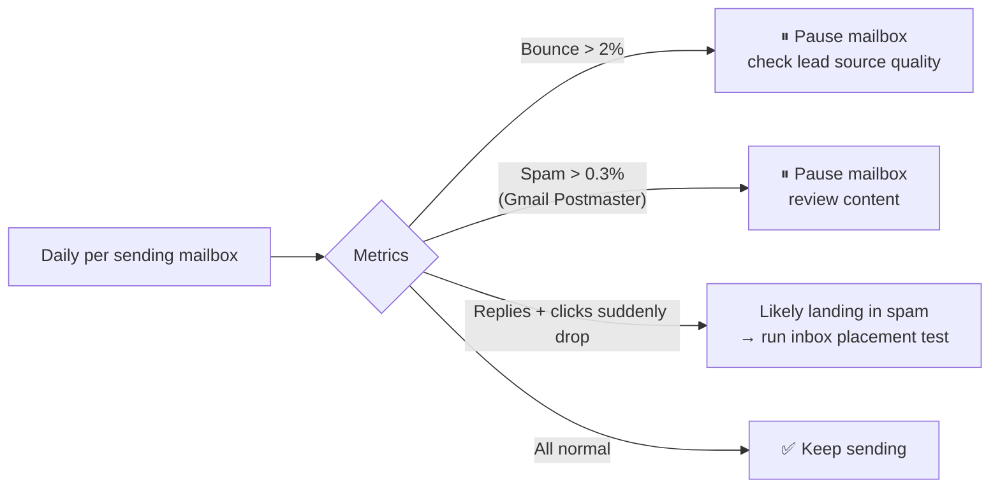

**Sending rules:** business hours in lead's timezone · no weekends/holidays · every email has a booking link + one-click unsubscribe · all links tracked with a purpose tag.


---

## 6. Reply classifier — the brain of response handling

Any reply (email or WhatsApp free text) goes through this. Clicks and opens are handled in section 5. **Sequence pauses the moment a reply arrives.**

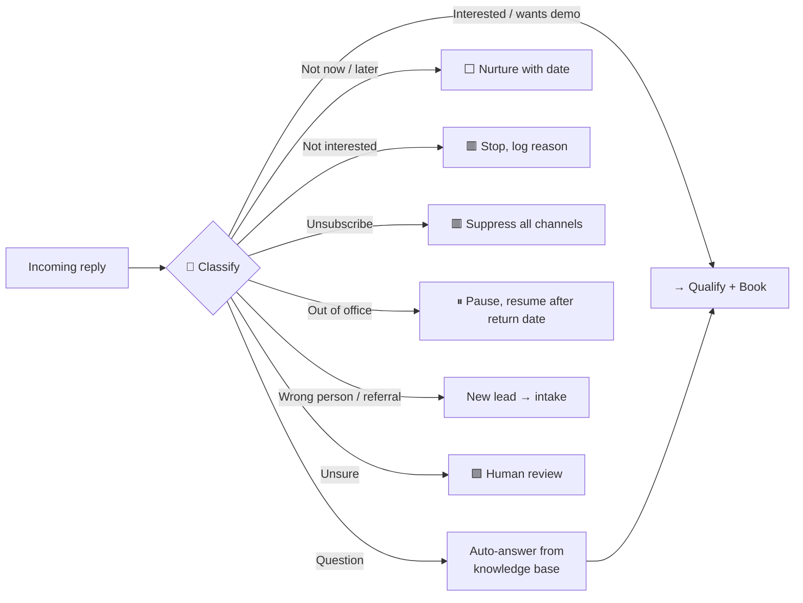

**Interest signals — what counts:**

| Signal | Use it? | Reason |
|---|---|---|
| Positive reply | ✅ Strong | Real intent |
| Booking link clicked + booked | ✅ Strong | Real intent |
| Pricing page visit (tracked) | ✅ Medium | Needs site tracking (after approval) |
| Pricing / booking click (human) | ✅ Medium-strong | See 5e |
| Other link click (human) | 🟡 Weak-medium | Bots filtered first (5b) |
| Email open | ❌ Never | Apple Mail fakes opens, Outlook hides them — logged for reports only |

---

## 7. WhatsApp flow v2 (opt-in leads only)

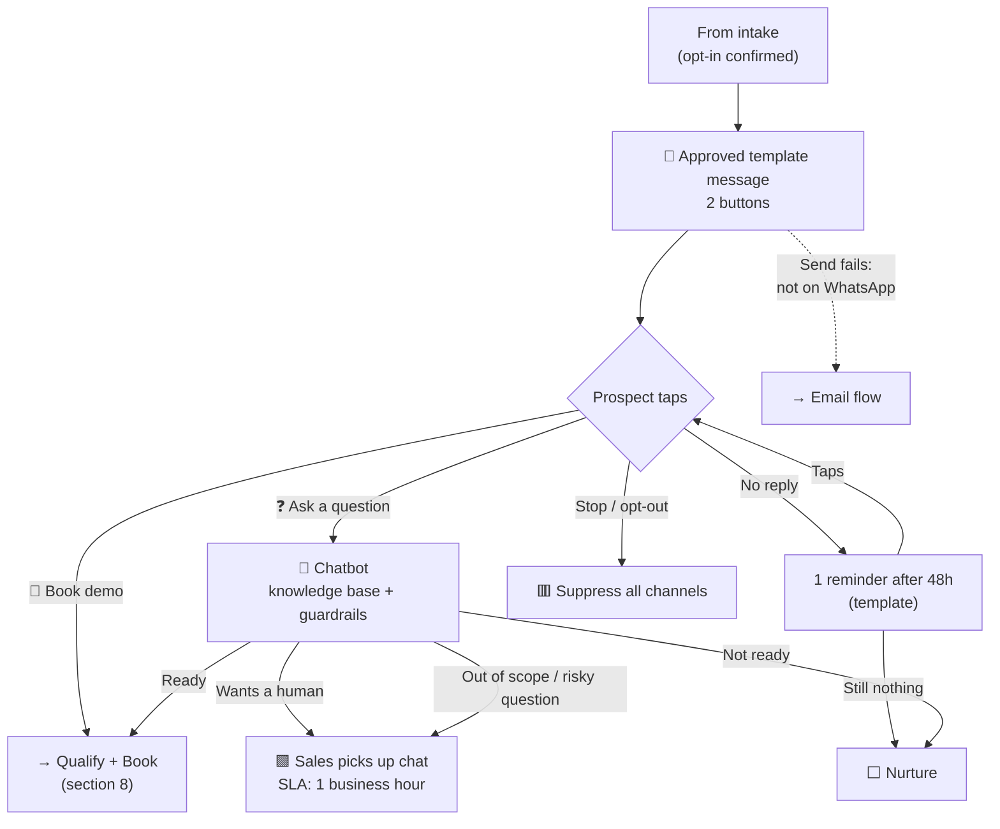

**WhatsApp limits to design around:**

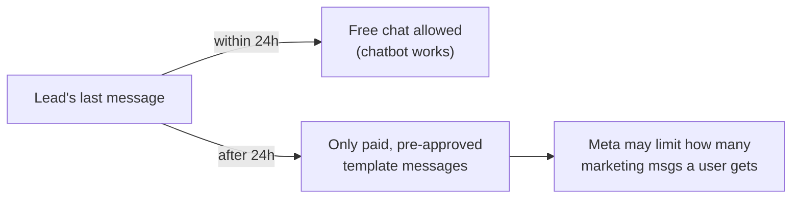

**Chatbot guardrails:** never quote custom prices · never promise features/timelines · hand to human when unsure · log every chat for review.

---

## 8. Qualify + Book (shared by both channels)

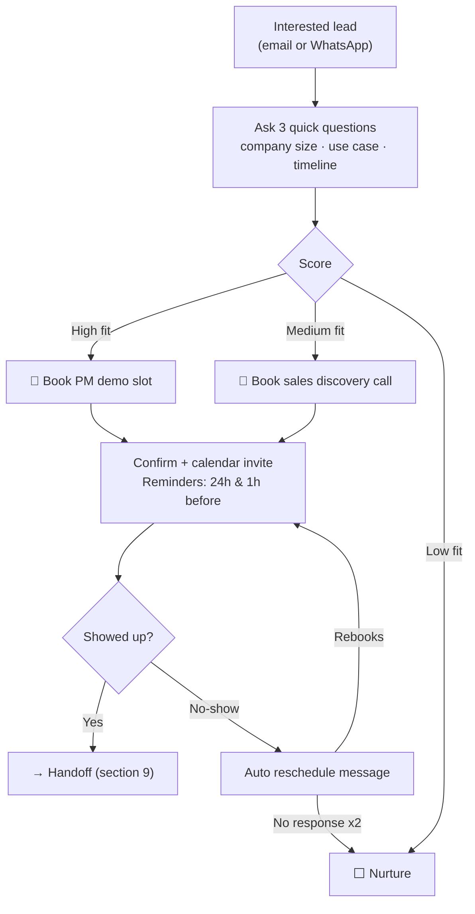

**Why:** in the old PDF anyone could book the PM directly → PM calendar becomes the bottleneck. Now only high-fit leads reach the PM.

---

## 9. Handoff to sales — where our job ends

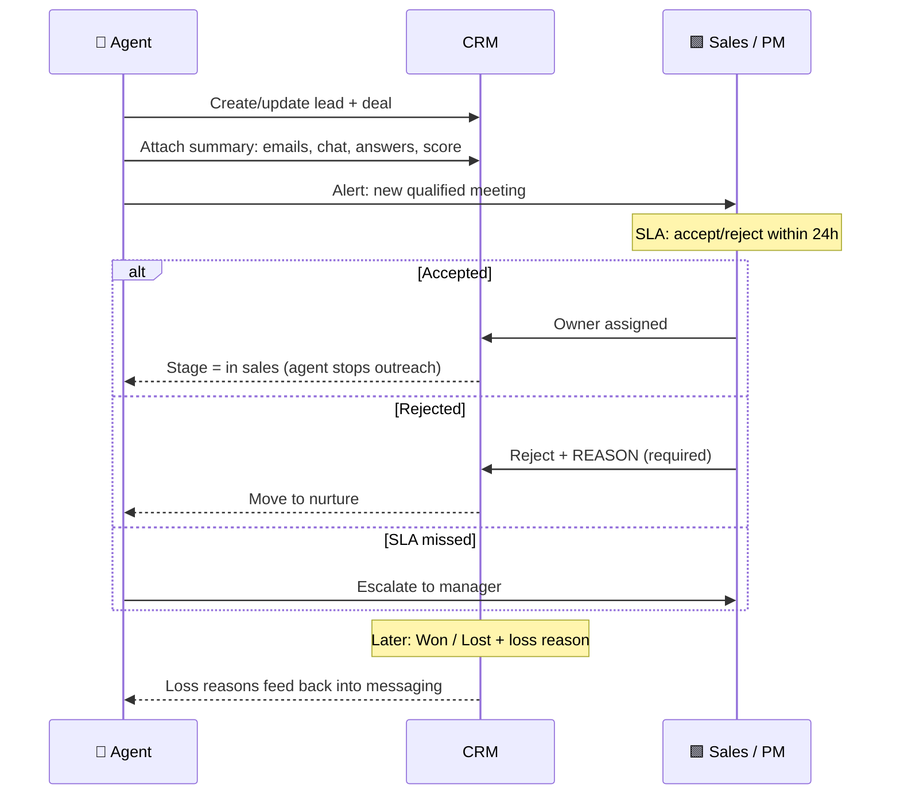

---

## 10. Nurture loop — with exits (the old PDF had none)

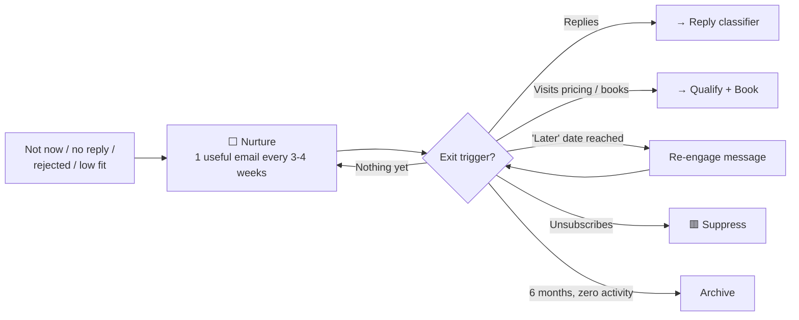

---

## 11. One lead, one state (across both channels)

Every lead has **exactly one** state at a time — this stops double-messaging.

```mermaid
stateDiagram-v2
    [*] --> Intake
    Intake --> Rejected: no valid email and no WhatsApp opt-in
    Intake --> Suppressed: opted out before
    Intake --> InSequence: clean
    Intake --> Paused: EU hold / colleague active

    InSequence --> Engaged: replied / tapped / hot score
    InSequence --> Nurture: no reply after sequence
    InSequence --> Paused: out of office
    Paused --> InSequence: return date / EU approved / colleague restart (table below)
    InSequence --> Suppressed: bounce / unsubscribe

    Engaged --> Qualifying
    Engaged --> Nurture: not now
    Engaged --> Closed: not interested

    Qualifying --> Booked: fit
    Qualifying --> Nurture: low fit
    Booked --> HandedOff: attended
    Booked --> Qualifying: no-show, rebook
    HandedOff --> Nurture: sales rejected
    HandedOff --> [*]: sales owns it

    Nurture --> Engaged: trigger
    Nurture --> Archived: 6 months silent
    Suppressed --> [*]
```

**Account rule:** if anyone at a company reaches `Engaged`, all their colleagues → `Paused`. New leads from that company are held too.

**When paused colleagues restart** — depends on what happened to the person who engaged (e.g. CEO engaged, CTO paused):

| CEO's outcome | CTO |
|---|---|
| Still talking (Engaged) | Restarts after **14 days** with no message from the CEO |
| Qualifying / booked / handed to sales | **Stays paused** — sales owns the account |
| "Not now" | Restarts on the CEO's **"later" date** (or after 90 days if no date) |
| Sales rejected the meeting | Restarts **now** |
| "Wrong person" | Restarts **now** |
| Not interested / unsubscribed / low fit | Restarts after **90 days** |

If two colleagues are both active, the CTO waits for the later of the two. A restarted colleague continues their own sequence where it stopped.

---

## 12. System building blocks

```mermaid
flowchart TB
    subgraph IN["Inputs"]
        LS["Lead sources<br/>CSV · API · forms"]
    end
    subgraph CORE["Agent core"]
        DB[("Lead DB<br/>state · consent · suppression")]
        ORC["Orchestrator<br/>schedules next step per lead"]
        LLM["LLM<br/>write emails · classify replies · chatbot"]
        KB[("Knowledge base<br/>Ozoo.ai services, FAQs")]
    end
    subgraph CH["Channels"]
        ESP["Cold-email tool<br/>sends from real inboxes<br/>warm-up + tracking"]
        WAB["WhatsApp Business API"]
        CAL["Calendar<br/>PM + sales slots"]
    end
    subgraph OUT["Outputs"]
        CRM["CRM"]
        DASH["Metrics dashboard"]
    end

    LS --> DB
    DB <--> ORC
    ORC <--> LLM
    LLM <--> KB
    ORC --> ESP
    ORC <--> WAB
    ORC <--> CAL
    ESP -->|"replies, bounces"| ORC
    ORC --> CRM
    CRM -->|"stage changes"| ORC
    DB --> DASH
```

**Open decisions:** which CRM · which WhatsApp provider. Email sending + tracking stack → section 17.

### 12b. How emails are sent & tracked (decision needed)

Cold email must go from **real Google Workspace / Microsoft 365 inboxes** (bulk services like SendGrid forbid cold email). Real inboxes report nothing back, so tracking needs a layer on top:

```mermaid
flowchart LR
    Q{"How do we get<br/>tracking events?"}
    Q -->|"Option A — Recommended v1"| A["Cold-email tool<br/>Instantly / Smartlead / lemlist<br/>✅ warm-up, tracking, webhooks ready<br/>💰 monthly fee per inbox"]
    Q -->|"Option B"| B["Build our own<br/>tracking server + bounce parser<br/>✅ full control<br/>⏳ weeks of extra work"]
    A --> AG["🤖 Our agent makes all decisions<br/>tool only sends + reports"]
    B --> AG
```

**Tracking vs. deliverability:** tracking pixels and rewritten links slightly raise spam risk. Rules: own tracking domain (e.g. `go.ozoo.ai`) · 1–2 links per email · **open-pixel off** (opens are never used for decisions, so the pixel only costs deliverability).

---

## 13. What we measure

```mermaid
flowchart LR
    A["Leads in"] --> B["Passed intake<br/>target > 85%"]
    B --> C["Contacted"]
    C --> D["Replied<br/>target 5-10%"]
    D --> E["Positive reply"]
    E --> F["Meeting booked"]
    F --> G["Showed up<br/>target > 70%"]
    G --> H["Accepted by sales"]
    H --> I["Won"]
```

Track per **lead source** and per **channel**. Also track: bounce rate (< 2%), spam complaints (< 0.3%), sales SLA hits, loss reasons.

---

## 14. Build order

```mermaid
flowchart LR
    P1["Phase 1<br/>Intake gate<br/>Lead DB + states<br/>Email sequence"] --> P2["Phase 2<br/>Reply classifier<br/>Qualify + Book<br/>CRM handoff"]
    P2 --> P3["Phase 3<br/>WhatsApp (opt-in)<br/>Chatbot + KB"]
    P3 --> P4["Phase 4<br/>Nurture triggers<br/>Dashboard"]
    P4 --> P5["v2 — only if data says so<br/>AI voice call"]:::later
    classDef later fill:#eee,stroke:#999,stroke-dasharray:5 5
```

---

## 15. Cut from v1

| Old PDF item | Decision | Why |
|---|---|---|
| E1/W1 lead research | ❌ Removed | Not our job; replaced by intake gate |
| E10–E14, W13–W16 (proposal → close) | ➡️ CRM / sales | Not agent work; we only read stage back |
| W7 AI voice call | ⏸ v2 | Costly, rarely used in B2B |
| 4 WhatsApp buttons | ✂️ 2 buttons | Only 3 show on screen; fewer choices = more taps |
| E6 retry same campaign | ❌ Removed | Re-blasting non-responders hurts deliverability |
| Opens as a signal | ❌ Not used | Unreliable; logged for reports only, never drive an action |
| "Never opened → try WhatsApp" after Email 4 | ❌ Removed | WhatsApp opt-in leads already get WhatsApp on day 1 |
| Rejecting email leads without opt-in | ❌ Removed | Cold B2B email doesn't need permission; only WhatsApp does |

---

## 16. Is it all achievable? (reality check)

| Item | Status | Note |
|---|---|---|
| Delivered / bounce / reply / unsubscribe / booking | ✅ Reliable | |
| Which link clicked | ✅ Reliable | Own tracking domain |
| Bot click filtering | 🟡 Mostly | Some false clicks slip through |
| Opens | 🟡 Partial | Apple auto-opens, Outlook blocks images — logged only, never acted on |
| Opened 3+ times, open-time | ⚠️ Weak | Not used |
| Website visits after click | 🟡 If we control ozoo.ai | **Needs approval first**; cookie consent can block in EU |
| Spam complaint per lead | ❌ Rare | Use mailbox-level spam % instead |
| Forwarded | ❌ Not possible | Removed from plan |
| Inbox vs spam folder per email | ❌ Not possible | Use test inboxes (5j) |
| WhatsApp sent/delivered/failed/taps/opt-out | ✅ Reliable | |
| WhatsApp "read" | 🟡 Partial | Only if read receipts on |
| WhatsApp number check before sending | ❌ Not possible | Detected at first send |
| Reply classifier, chatbot, scoring, booking, CRM sync, SLA alerts | ✅ Buildable | Standard tools/APIs |
| Email verification | 🟡 Mostly | Catch-all domains return "unknown" |
| Timezone of lead | 🟡 Guessed | From country/company location |

---


---

## 17. Email tracking — exactly what we use

Three sources of events, all feeding one webhook receiver in our agent:

```mermaid
flowchart LR
    AG["🤖 Our agent<br/>webhook receiver + rules"]
    AG -->|"send via API"| TOOL["Cold-email tool<br/>Instantly or Smartlead"]
    TOOL -->|"sends from"| INB["Google Workspace /<br/>Microsoft 365 inboxes"]
    INB --> LEAD["📥 Lead's inbox"]

    LEAD -->|"opens"| PX["Tool's open pixel<br/>(custom tracking domain)"]
    LEAD -->|"clicks link"| RD["Our redirect<br/>go.ozoo.ai/r/lead/tag"]
    LEAD -->|"replies / bounces /<br/>unsubscribes"| TOOL
    LEAD -->|"books"| CAL["Cal.com"]

    PX -->|"webhook: opened"| AG
    TOOL -->|"webhooks: sent · reply ·<br/>bounce · unsubscribe"| AG
    RD -->|"logs time · IP · user-agent · tag<br/>→ bot filter → redirect to page"| AG
    CAL -->|"webhook: booked"| AG
    AG -->|"reply text"| LLM["Claude API<br/>reply classifier"]
```

| Event | Comes from | How |
|---|---|---|
| Sent · bounced · replied · unsubscribed | Cold-email tool | Webhook (fallback: poll its API every 5 min) |
| Opened | Cold-email tool pixel (recommended **off**) | Webhook — logged only, never acted on |
| **Which link was clicked** | **Our own redirect endpoint** | We build it: logs event, runs bot filter, redirects |
| Booked meeting | Cal.com | Webhook |
| What a reply means | Claude API | Classifier on reply text |
| Email valid before sending | ZeroBounce / NeverBounce | API at intake |
| Spam rate per inbox | Google Postmaster Tools | Checked daily |

**Why our own redirect for clicks:** it gives us the link's purpose tag, exact timestamp, IP and user-agent — exactly what the bot filter (5b) needs. Most tools only report "clicked", not reliably which link. It's one small endpoint.

**Check before buying the tool:** the plan must include **API access + webhooks** (not every tier does).

---

## 18. What ships tomorrow vs. later

```mermaid
flowchart LR
    subgraph D1["✅ BUILD TOMORROW (code-complete + tested)"]
        direction TB
        A1["Lead DB + states + suppression"]
        A2["Intake gate + dedup + account rule"]
        A3["Email sequence via tool API"]
        A4["Webhook receiver"]
        A5["Click redirect + bot filter"]
        A6["Event → action rules (5i)"]
        A7["Engagement score"]
        A8["Claude reply classifier"]
        A9["Cal.com booking + webhook"]
        A10["Sales alerts (Microsoft Teams / email)"]
    end
    subgraph WAIT["⏳ NEEDS OUTSIDE WAITING"]
        direction TB
        B1["Inbox warm-up<br/>2–3 weeks for new inboxes"]
        B2["Meta business verification<br/>+ template approval: days"]
    end
    subgraph LATER["⏭ NEXT ITERATIONS"]
        direction TB
        C1["WhatsApp flow + chatbot"]
        C2["Nurture automation"]
        C3["CRM sync"]
        C4["Website tracking script<br/>(after approval)"]
        C5["Dashboard"]
        C6["AI voice call"]
    end
    D1 --> WAIT --> LATER
```

**Important:** "done tomorrow" = the agent is built and tested end-to-end with test inboxes. A full 4-email sequence takes 15+ days to play out, and new inboxes need warm-up before real volume — so **live results come later than the code**.

### Start these TODAY (they take time, code doesn't)

| # | Task | Why today |
|---|---|---|
| 1 | Sending inboxes on a **separate domain** (e.g. ozoo-mail.ai), start warm-up | Warm-up takes 2–3 weeks; never cold-email from the main ozoo.ai domain |
| 2 | DNS: SPF, DKIM, DMARC + CNAME for tracking domain | Propagation can take hours |
| 3 | Cold-email tool account with API + webhooks | Needed to send |
| 4 | Cal.com: PM demo + sales call event types | Booking links in emails |
| 5 | API keys: Anthropic, email verification | Classifier, intake |
| 6 | Public HTTPS host for webhooks (Render / Railway / VPS) | Tools must reach our server |
| 7 | Meta Business verification + submit WhatsApp templates | Approval takes days — start the clock |
| 8 | **Approval: cold email to EU leads** (GDPR legitimate-interest check) | Until approved, EU leads are held with no email |
| 9 | **Approval: website tracking script** (cookie consent) | Script stays off until approved |

### Tomorrow's build order

```mermaid
flowchart LR
    S1["1 · DB + states<br/>+ intake gate"] --> S2["2 · Webhook receiver<br/>+ click redirect"]
    S2 --> S3["3 · Sequence sender<br/>+ rules engine"]
    S3 --> S4["4 · Claude classifier<br/>+ Cal.com booking"]
    S4 --> S5["5 · Alerts + score"]
    S5 --> S6["6 · End-to-end test<br/>with 3–5 test inboxes"]
```

**Test script (step 6):** send to own test inboxes and trigger each event — open (must change nothing), pricing click, booking, reply "interested", reply "not now", out-of-office, unsubscribe, a fake address for bounce. Each must land in the right state.

---

## ❓ One question that changes the design

```mermaid
flowchart LR
    Q{"Do incoming leads come<br/>with WhatsApp opt-in?"}
    Q -->|Yes| A["WhatsApp = main channel<br/>Email = backup"]
    Q -->|No| B["Email = main channel<br/>WhatsApp only after they engage<br/>and share number + consent"]
```
