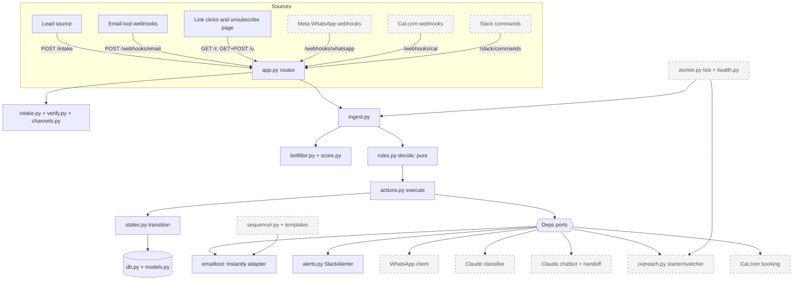

# Architecture

## Module map

Solid boxes exist today. Dashed boxes are planned (tasks 7-13).

## How an event flows

1. **Webhook arrives** (for example an email reply). The route checks size (1 MiB cap) and the signature or shared secret. Bad secret gives 401.
2. **Adapter normalises** the payload into `NormalizedEvent` (kind, channel, lead hints, provider event id).
3. **Ingest** inserts the event inside a savepoint. A repeated `provider_event_id` is skipped, so retries are safe.
4. **Match lead:** by `lead_id`, tool lead id, email, phone, then (replies only) company domain. No match gives an `unmatched_*` alert.
5. **Verdict:** bot filter marks opens/clicks `human`, `bot` or `machine`. Only `human` events change the flow.
6. **Decide:** `rules.decide()` is pure. It takes snapshots of lead and event and returns an ordered list of actions. No DB, no I/O.
7. **Execute:** `actions.execute()` applies each action. State changes go through `states.transition()`. External calls (email tool, WhatsApp, Slack) go through `Deps` ports. A failing port becomes an `integration_error` row and the rest continues.
8. **Commit:** ingest owns the commit. Any error rolls back and returns 500 so the provider retries.
9. **Slack after commit:** alerts are written as rows during step 7, but posted to Slack only after the commit succeeds. Failed posts keep `posted_at` empty for a worker retry (task 12).

Clicks are stored unprocessed and decided later by the worker (30 s settle window, so two-link scanner bursts can be spotted). The unsubscribe click is the exception: the GET only redirects to a confirm page, and the POST opts the lead out.

## Module table

| Module | Responsibility | Built in | Exists |
|---|---|---|---|
| `config.py` | Settings from env, secret strength checks | Task 1 (hardened in 4) | yes |
| `db.py` | Engine, session, UTC datetime type, SQLite transaction fix | Task 2 (fix in 6) | yes |
| `models.py` | Lead, Event, ChatMessage, Suppression, Alert | Task 2 | yes |
| `states.py` | LeadState, allowed transitions, `transition()` | Task 2 | yes |
| `verify.py` | ZeroBounce email verifier | Task 3 | yes |
| `channels.py` | Phone normalising, `choose_channel`, `fallback_channel` | Task 3 | yes |
| `intake.py` | Intake gate: validate, suppress, dedup, account hold | Task 3 | yes |
| `links.py` | Signed tracked-link tokens | Task 4 | yes |
| `botfilter.py` | Classify events as human / bot / machine | Task 4 | yes |
| `score.py` | Engagement points, decay, bands | Task 4 (pure `points_for` in 5) | yes |
| `actions.py` | Action dataclasses, `Deps` ports, `execute()` | Task 5 (dataclasses), 6 (executor) | yes |
| `rules.py` | `decide()`: events to actions, both channels | Task 5 | yes |
| `http.py` | Retrying HTTP helper with timeouts | Task 6 | yes |
| `emailtool/base.py`, `fake.py`, `instantly.py` | Email tool port, test fake, Instantly adapter | Task 6 | yes |
| `alerts.py` | Alert rows plus Slack post after commit | Task 6 | yes |
| `ingest.py` | Shared event pipeline: dedup, match, verdict, decide, execute, commit | Task 6 | yes |
| `app.py` | FastAPI: `/webhooks/email`, `/r`, `/u`, `/intake`, `/healthz` | Task 6 | yes (more routes planned) |
| `unsubscribe_page.py` | Confirm and success HTML for `/u/{token}` | Task 6 | yes |
| `sequencer.py`, `templates/emails.yaml` | Email enroll, variants, end-of-sequence routing | Task 7 | planned |
| `whatsapp/client.py`, `whatsapp/webhook.py` | Cloud API client and webhook parser | Task 8 | planned |
| `classifier.py` | Claude reply classification | Task 9 | planned |
| `chatbot.py`, `handoff.py` | WhatsApp bot, Slack takeover | Task 10 | planned |
| `booking.py` | Cal.com events, fit routing, handoff summary | Task 11 | planned |
| `outreach.py`, `worker.py`, `health.py` | Start/switch channel, 60 s tick, mailbox health | Task 12 | planned |
| `Dockerfile`, runbook, e2e checklist | Deploy and verify | Task 13 | planned |
